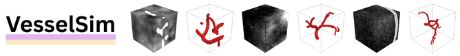

**TL;DR** *This project page provides the code to generate VesselSim's high tortuosity synthetic blood vessels and skull-injected samples.* 

---
**VesselSim** is  a two-stage framework for universal 3D blood vessel segmentation that eliminates the need for 
real annotated data during training. First, we introduce a stochastic, geometry-driven vascular simulation framework that
models recursive branching, curvature-controlled growth, and collision-aware topology, followed by domain-randomized 
intensity synthesis to generate 16,500 anatomically plausible 3D angiographic volumes . Second, a 3D U-Net is trained 
solely on this synthetic data. To bridge the domain gap from synthetic to real images at inference time, we introduce a 
test-time adaptation strategy via a self-supervised mask reconstruction decoder, enabling adaptation to unseen
clinical scans without prior domain knowledge. 

For more details, please refer to our [manuscript](https://arxiv.org/abs/2605.26277), our 
[publicly available data](https://osf.io/8n5wu/overview), and the full [project page](https://healthx-lab.github.io/VesselSim).

# Installation
First, set up a conda environment and install dependencies:
```
conda create -n vesselsim python=3.12
conda activate vesselsim
pip install -r requirements.txt
```

# Data Generation Instructions
The full VesselSim dataset is seperated into low-tortuosity vessels, high-tortuosity vessels, background samples, and 
skull-injected samples.

1. The low-tortuosity vessel samples are generated using the [VascuSynth](https://vascusynth.cs.sfu.ca/) vascular simulation 
framework for straighter, tree-like structures. Please refer to their software and instructions to generate these samples.
2. The high tortuosity vessel sample instructions and code are available [here](VesselSim/HighTortuosity/README.md).
3. The background samples are 96x96x96-voxel empty .npy volumes, one sample volume is available [here](VesselSim/BackgroundSample/README.md).
4. The skull-injected samples are any of the three other vessel volumes augmented with ellipsoidal shell structures designed to simulate 
skull or bone anatomy in angiographic imaging. The instructions and code are available [here](VesselSim/InjectedSkull/README.md).

Each segmentation mask is then paired with a corresponding synthetic angiography image generated using the domain-randomized 
rendering pipeline introduced in [VesselFM](https://github.com/bwittmann/vesselFM): _D<sub>drand</sub>_. The high tortuosity code generates 
the volumes in the correct format to be easily run with VesselFM. Please refer to their code and instructions to generate 
the angiographic image volumes.

# Citing VesselSim
The VesselSim paper has been accepted into the MICCAI 2026 conference. The peer reviewed, finalized copy will be available
in October 2026. The unofficial version is currently available on [arXiv](https://arxiv.org/abs/2605.26277).
If you find our work useful for your research, please cite:
```
@misc{rainville2026vesselsim,
      title={VesselSim: learning 3D blood vessel segmentation without expert annotations}, 
      author={Erin Rainville and Melissa Ananian and Tristan Mirolla and Hassan Rivaz and Yiming Xiao},
      year={2026},
      eprint={2605.26277},
      archivePrefix={arXiv},
      primaryClass={cs.CV},
      url={https://arxiv.org/abs/2605.26277}, 
}
```

## Notes
> The index.html file and static folder contain the source code for the VesselSim project page based on the [Nerfies website](https://nerfies.github.io).
