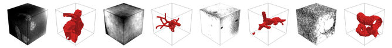

# High Tortuosity Vessel Generation
In our experiments, we created 5000 high tortuosity blood vessel masks for training and an additional 500 masks for validation. 

We incorporate a biased random walk into a stochastic recursive branching system to control segment trajectories, enabling 
curvature and directional persistence. Segment length, rotation axis, and rotation magnitude are sampled from defined 
probabilistic ranges, and growth proceeds in a breadth-first manner within a 160 × 160 × 160 voxel volume to ensure 
uniform spatial density. Collision avoidance is enforced via multi-attempt path validation, terminating branches when no 
feasible path exists. Additionally, branching probability decays with depth while radii decrease following physiological 
scaling consistent with Murray’s law. 

# 1. Parameter Setting
Our vessel builder is based off of a parameter file so that the generated vessels have more controllable results. The list
of parameters are:
```
{
      "anatomical_context": "string",
      "root_geometry": {
        "origin_voxel": [x, y, z],
        "initial_direction": [x, y, z],
        "initial_radius": float
      },
      "branching_model": {
        "max_depth": int,
        "bifurcation_probability": float,
        "bifurcation_depth_decay": float,
        "bifurcation_angle": float,
        "termination_factor": float,
        "segment_length_vox": { "min": int, "max": int },
        "max_total_segments": int
      },
      "radius_model": {
        "min_radius_vox": float,
        "radius_decay_factor": float
      },
      "tortuosity_model": {
        "segment_max_curvature": float,
        "collision_jitter_scale": float
      }
}
```
Some sample parameter files are available in the [vessel_parameters](vessel_parameters) folder. These parameters can either be filled
manually or, using our [prompt manager](1_prompt_manager.py) script. The prompt manager uses [Google Gemini API](https://aistudio.google.com/)
to automatically generate these parameter files. The prompt given to Gemini is available [here](system_prompt.txt).

To run the prompt manager script, fill out the [prompt_config](prompt_config.yaml) file with your personal Google API key
and the number of parameter files to generate. Then run:
```
python 1_prompt_manager.py
```

# 2. Generating Initial Masks
The [vessel builder](2_vessel_builder.py) is our proposed stochastic recursive branching framework. It takes as input 
the created parameter files to generate random blood vessels. As this is a stochastic process, one parameter file can be 
used to generate multiple masks. Some sample initial masks are available in the [tmp](tmp) folder. These masks are generated 
in 160 × 160 × 160 voxel volumes to ensure the vessels can be generated without colliding with borders too early.

To run the vessel builder script, fill out the [generation_config](generation_config.yaml) file with the number of masks
to generate per parameter file. The outputs will be labeled as {parameter file name}_{mask count}.npy. Then run:
```
python 2_vessel_builder.py
```

# 3. Extracting Patches
[Patch extraction](3_extract_patches.py) takes the initial 160 × 160 × 160 voxel volumes and extracts 96 × 96 × 96 voxel 
patches that have passed an automatic quality control based on criteria of flow continuity, vessel integrity (no small 
"floating islands"), and a 5\% minimum vessel occupancy threshold. The resulting masks are generated in the format compatible
with [VesselFM](https://github.com/bwittmann/vesselFM) domain randomization scripts. Some sample final masks are availble
in the [final_vessels](final_vessels) folder. 

Run the patch extraction script:
```
python 3_extract_patches.py
```

# 4. Visualizing masks
You can visualize a mask by running the [visualization script](4_visualize_mask.py) with the desired mask file. Here is an example:
```
python 4_visualize_mask.py --mask final_vessels/2/mask_vessel_000_02.npy
```

# 5. Generating Image Volumes
Each segmentation mask is then paired with a corresponding synthetic angiography image generated using the domain-randomized 
rendering pipeline introduced in [VesselFM](https://github.com/bwittmann/vesselFM): _D<sub>drand</sub>_. Please refer to 
their code and instructions to generate the angiographic image volumes.

# Note
The VesselSim framework is a stochastic branching algorithm and the results are not always perfect. You may want to visualize
the results to ensure the quality of the generated vessels. Additionally, some parameter combinations can result in highly
erroneous vessels and can benefit from removing these parameter files from your generation pipeline. However, we trained our
VesselSim U-Net network using our full [dataset](https://osf.io/8n5wu/overview) without removing unrealistic masks and 
still achieved performance competitive with state-of-the-art vascular segmentation foundation models. 

Here are some unrealistic generation results:

