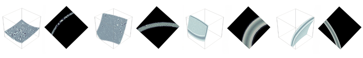

# Skull-injected Vessel Generation
This module injects synthetic vessel volumes with skull-like structures. In our experiments, 
we generated 2,500 skull-injected vessel volumes for training and 250 volumes for validation.

The goal of this step is to make the synthetic angiography images more realistic by adding a skull or bone-like shell 
around the vessels, while ensuring that the final vessel mask remains consistent with the visible vessel region.

# 1. Generating skull labels

The [generation script](1_generate_skull_labels.py) creates the ellipsoidal shell structures designed to simulate skull 
or bone-like anatomy in agiographic imaging. The [skull labels folder](skull_labels) already contains nine generated samples. The 
skull samples contain two files (**images** and **labels**). The images folder contains the skull intensity images. These are 
normalized between 0 and 1 and are later blended into the vessel image so that the skull structure is visible while 
preserving the original synthetic image texture. The labels folder contains the corresponding skull label maps. These 
labels are used during skull injection to identify which parts of the volume should be considered outside the skull region 
and replaced with background.

To run the generation script fill out the first two parameters in [skull_config](skull_config.yaml) with the number of skulls 
 to generate and the output location. Then run:
```
python 1_generate_skull_labels.py
```

To visualize these skull labels, the [visualization script](3_visualize_skull_labels.py) takes as input the images folder and
displays nine samples. Run:
```
python 3_visualize_skull_labels.py
```


# 2. Injected skulls into vessel images
The [injection script](2_inject_skull_to_vessels.py) combines synthetic vessel volumes with skull samples. For each final output volume,
the script randomly selects:
- one synthetic vessel image and mask pair
- one background image
- one skull image and label pair

The vessel masks were generated using either the high tortuosity or low tortuosity strategies while the background masks are
simply an empty volume. The vessel and background images were generated using  [VesselFM's](https://github.com/bwittmann/vesselFM) 
_D<sub>drand</sub>_ algorithm. Thus, the vessel and background folders used in this script are already in the VesselFM format.

The process of generating the final skull-injected volume goes as follows. The skull image is added into the vessel image using 
maximum-intensity blending. This makes the skull structure visible while preserving the existing vessel and background texture.
The skull label indicates the "outside" of the skull, we use this label to replace the vessel image outside the skull region
with the background image. Then, any vessel mask voxels that fall outside the skull region are removed. This ensures 
that the final vessel mask only contains vessels that are visible in the final image. Finally, the generated image and mask
are saved in the VesselFM file format.

To run the injection script, the [skull_config](skull_config.yaml) takes as input the skull directory as defined in step 1, 
the vessel directory, the background directory, the final output location, as well as the number of volumes to generate. 
Some sample background and high tortuosity volumes are available in the [VesselFMSamples folder](../VesselFMSamples). Then run:
```
python 2_inject_skull_to_vessels.py
```

You can visualize the final image volume and mask by running the [visualization script](4_visualize_final_volumes.py) with
the desired skull folder. The result is saved as [skull_visualization.png](skull_visualization.png). Here is an example:
```
python 4_visualize_final_volumes.py --volume injected_skulls/1
```

